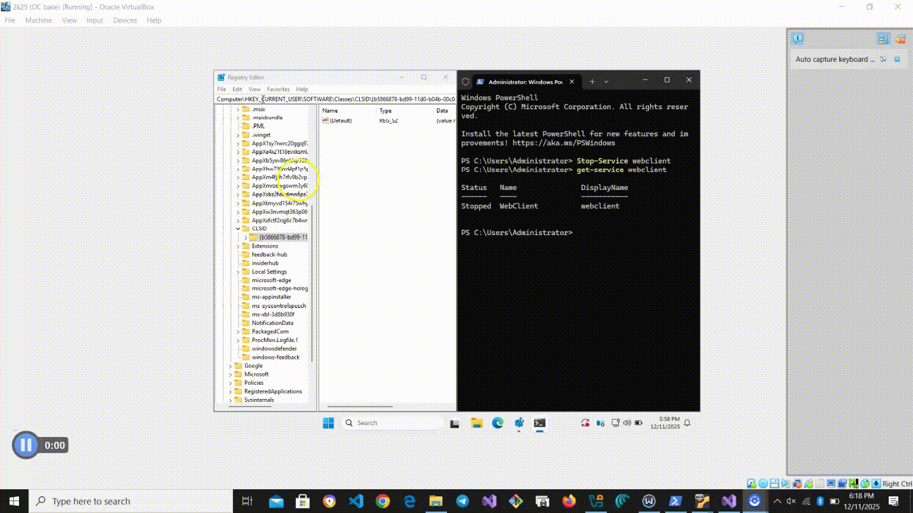

# KnightMove

A Windows lateral movement tool that abuses core Windows components — the Service Control Manager (SCM), Windows Registry, and COM class registration — to stage and load a remote DLL via WebDAV.

> ⚠️ **For authorized security testing and research only.** See [Disclaimer](#disclaimer).

---

## Demo

<!-- Replace the path below with the path to your uploaded GIF -->



---

## Overview

KnightMove demonstrates a lateral movement technique that combines COM hijacking with WebDAV-based remote file hosting.

It enables two Windows services required for the operation, registers a user-supplied CLSID under the current user's registry hive, and points it to a DLL hosted on a WebDAV server.

When the target process loads the registered COM object, it retrieves and loads the staged DLL from the remote location.

## How It Works

### 1. Service Configuration

KnightMove connects to the Service Control Manager (SCM) on the target system and modifies the startup configuration of the following services:

| Service | Change |
|---|---|
| **Remote Registry** | Startup type → `Automatic` |
| **WebClient** | Startup type → `Automatic` |

These services support the subsequent registry and WebDAV operations.

### 2. Registry Modification

The tool creates a registry key under:

```text
HKCU\Software\Classes\CLSID\{CLSID}
```

The `{CLSID}` value is supplied by the user and should correspond to a COM class relevant to the intended target process.

This registers the COM class under the current user's registry hive.

### 3. Staged DLL Loading

The DLL referenced by the CLSID registration is hosted on a WebDAV server.

Once the registry entry and required services are configured, the target process can load the DLL from the remote WebDAV location without requiring a traditional local file drop.

This demonstrates how remote file hosting can be combined with COM-based DLL hijacking in a lateral movement scenario.

---

## Requirements

- A WebDAV server hosting the staged DLL.
- A CLSID relevant to a COM object loaded by the intended target process.
- Network connectivity between the target and the WebDAV server.
- Appropriate authorization to perform the test.

**Demo target:** Windows Explorer (`explorer.exe`).

## Credits & Acknowledgements

This project builds on previous research and public presentations.

- **Kevin Ott** — Research presented at x33fcon 2025, which inspired and shaped this tool.

  [Watch the presentation](https://youtu.be/C8i337_BdvE)

- **Matthew Eidelberg (@Black Hills Information Security)** — Research on COM-based DLL hijacking, which helped establish the technical foundation for this technique.

  [Watch the presentation](https://www.youtube.com/live/1OzeSv9mUOk)

## Disclaimer

KnightMove is intended solely for legitimate security research, authorized red team engagements, and penetration testing.

The author is not responsible for any misuse or damage caused by this tool. 

---
